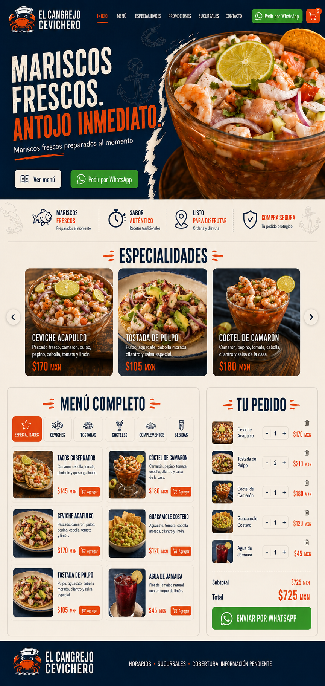
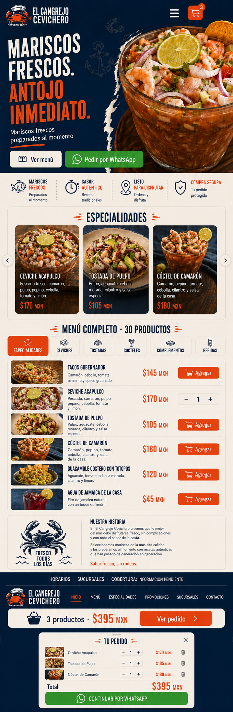

# El Cangrejo Cevichero

Landing page responsive para un restaurante de mariscos con menú digital, carrito de compra y generación de pedidos por WhatsApp.

## Demo

[Ver la demo publicada](https://ivterck1.github.io/LandingPedidosEnLinea/)

## Características

- Diseño responsive.
- Hero gastronómico.
- Menú filtrable por categorías.
- Carrito de productos.
- Persistencia mediante `localStorage`.
- Modificación de cantidades.
- Eliminación de productos.
- Cálculo de subtotal y total.
- Formulario de datos del cliente.
- Validaciones antes de generar el pedido.
- Generación automática del mensaje para WhatsApp.
- Panel de pedido optimizado para móvil.

## Tecnologías

- HTML5.
- CSS3.
- JavaScript Vanilla.
- Git.
- GitHub.
- GitHub Pages.

## Arquitectura

- `index.html`: estructura semántica, contenido y formulario del pedido.
- `css/styles.css`: sistema visual y comportamiento responsive mobile-first.
- `js/menu-data.js`: catálogo temporal de productos.
- `js/app.js`: renderizado del menú, filtrado, carrito, persistencia, validaciones y generación del enlace de WhatsApp.
- `assets/`: logotipos, fotografías y recursos visuales optimizados.

## Capturas

### Desktop

### Mobile

## Evolución futura

- Integración con una API y una base de datos.
- Catálogo de productos administrable.
- Persistencia de pedidos en un servicio remoto.
- Panel administrativo para gestionar productos y pedidos.

